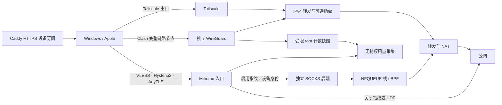

# 系统架构

入口监听 VLESS TCP 8443、Hysteria2 UDP 8443 和 AnyTLS TCP 9444。每种协议的用户身份映射到设备；启用指纹时 TCP 进入对应 SOCKS 后端，关闭时直接出站；UDP 根据入口规则直接出站。三种协议分别终结客户端和目标侧 TCP 连接。

Windows 后端运行在 `tcpfp-windows-test`，通过 `tfp-win0` 转发；Apple 后端运行在 `tcpfp-ios-test`，通过 `tfp-ios0` 转发。`tcpfp-network.service` 创建网络空间、veth、路由和专用防火墙规则，并维护 `/etc/netns/<名称>/resolv.conf`，供空间内普通程序通过 `1.1.1.1` 解析。每个网络空间有独立的 SYN 处理方式：Windows 使用 NFQUEUE，Apple 使用 tc/eBPF。指纹处理只作用于 IPv4 TCP SYN；UDP 和 QUIC 使用自己的协议栈。

`/etc/tcpfp/fingerprint-engines.json` 定义各出口的引擎，`/etc/tcpfp/syn-windows.json` 定义队列与 Windows 模板。Windows 队列服务和捕获服务在后端之前启动，队列失效时新连接被阻断。Apple 的 tc 程序附着在其出口网卡。

Mihomo 的 UID 防火墙限制入口进程访问本机和私网，放行设备后端、订阅端口、DNS 和已建立连接的应答。网络空间防护及宿主转发规则限制后端访问范围。Tailscale 使用原生三层转发。

Caddy 发布 HTTPS 订阅。DNS-01 证书由 acme.sh 续期，Mihomo 通过 systemd 凭据读取证书。用量采集器读取私有 Unix 控制套接字，将三个协议按设备身份汇总为累计计数。WireGuard 的内核计数由 root 定时快照服务读取，仅将计数交给无特权采集器；统计保留来源、采样缺口与原有累计值，不保存访问目标。

`vps-ops` 是统一管理入口。服务器本地执行检查与维护，Windows 本机通过原生 SSH 进入远程 CLI 长会话。部署检查配置位于 `/etc/vps-ops/config.yaml`，认证信息继续由现有服务配置与 systemd 凭据提供。用量与订阅策略服务调用同一 Python 包中的命令；离线成员材料和客户端配置生成也由该入口提供。操作及参数见 [CLI 手册](USAGE.md)。

新节点支持仅 Tailscale、仅 Mihomo 和两者同装。`deploy apply` 经原生 SSH 传输安装包，在服务器以 Ansible 本地连接执行初始化，系统更新需要重启时重新连接继续。节点身份由生成模块持久保存，证书申请、安装和续期统一调用 acme.sh，DNS 服务商只配置插件与凭据。运行配置的 mode 与 features 由 capabilities.py 统一解析，驱动依赖、服务、端口、生成和功能检查。配置在任何网络单元启动前写入；重复部署保留身份与用量，改选时停用淘汰服务及其自有规则。

## 三层完整链路与转发指纹

Clash 开启完整链路能力后安装独立 WireGuard 服务，接口为 `vps-ops`，UDP 端口为 51820。订阅增加 Windows、Apple 两个 WireGuard 节点，分别使用持久化的独立密钥和地址。每台物理设备有独立订阅令牌和两套指纹配置，各配置具备独立三协议凭据及 WireGuard 密钥/地址；每个订阅变体包含本设备全部八个节点。UA 仅调整默认和 TUN，未知 UA 使用登记平台。原有三协议继续提供分段 TCP 连接；WireGuard 与原生 Tailscale 将设备连接作为三层数据包转发，目标侧 TCP 的往返时间包含设备到 VPS 的路径。

三层路径的可选指纹由 NFQUEUE 处理 IPv4 SYN。WireGuard 按已认证的 peer 地址所属 /17 池选择 Windows 或 Apple；Tailscale 按原生连接是否协商时间戳选择可用的 Apple 或 Windows 选项布局。TTL 按设备族规范化。队列处理进程确认就绪后才安装捕获规则，WireGuard 等待该规则服务后启动。规则、NAT 与 UFW 转发授权分别由所属服务维护，停用时清理。宿主系统维护与管理连接独立保留。

## 物理设备与运行态变更

`fingerprint_profiles.py` 定义静态 Windows / Apple 指纹；`identity.py` 的注册表保存物理设备。每设备的 principal 为 `设备UUID.指纹key`，同时用于三协议与 WireGuard 记账。地址从 Windows、Apple 各自 /17 池单调分配，撤销后不立即重用。服务器 WireGuard 与 REALITY 密钥保持稳定；SOCKS 后端认证只在节点内部使用。

`device add/revoke/sync` 与部署共用 `/var/lib/vps-ops/deploy.lock`，生成器在调用方持锁的范围内工作。注册表持久保存意图后，更新代理认证及设备订阅，通过 Mihomo 私有 Unix 控制接口重载并关闭仅撤销 principal 的现有连接，使用 `wg syncconf` 增删 peers 和刷新精确来源白名单。正常设备变更不重启网络接口、Mihomo 或 Caddy；Caddy 使用固定规范 URL 匹配并读取原子文件，只有模板改变时才校验并优雅重载。

撤销清除设备秘密和令牌，仅保留 ID、名称、平台与撤销状态；采集配置继续提供所有历史 principal 的显示名。零活跃设备时移除公网 listeners，并允许空的采集用户清单。健康检查不会加载真实设备私钥发起 WireGuard 测试，读取 peer 配置及真实握手；设备同时连接的 HTTPS 行为由设备侧验证。

## CLI 代码职责

`arguments.py` 定义命令参数，`prompts.py` 收集交互输入，`cli.py` 调用操作并选择展示方式。状态采集、功能检查、成员材料、配置生成、订阅策略、证书及用量模块返回数据或抛出异常，由 `output.py` 排版为英文文本或序列化为 JSON。业务模块可直接调用，不修改 `sys.argv`，也不通过 stdout 传递返回值。

日志由 `runtime.journal` 读取并脱敏，以迭代器交付记录；CLI 消费记录并交给展示层，结束消费时关闭进程。用量报告直接读取现有数据库并返回结果，采集守护进程通过标准 logging 记录采样状态。部署过程通过通知和日志回调报告进度，SSH 生命周期仍由部署模块管理。
