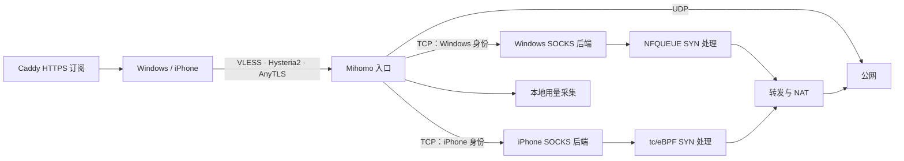

# 系统架构

入口监听 VLESS TCP 8443、Hysteria2 UDP 8443 和 AnyTLS TCP 9444。每种协议的用户身份映射到设备；TCP 进入对应 SOCKS 后端，UDP 根据入口规则直接出站。原生用户可以直接使用入口的普通出口。

Windows 后端运行在 `tcpfp-windows-test`，通过 `tfp-win0` 转发；iPhone 后端运行在 `tcpfp-ios-test`，通过 `tfp-ios0` 转发。`tcpfp-network.service` 创建网络空间、veth、路由和专用防火墙规则，并维护 `/etc/netns/<名称>/resolv.conf`，供空间内普通程序通过 `1.1.1.1` 解析。每个网络空间有独立的 SYN 处理方式：Windows 使用 NFQUEUE，iPhone 使用 tc/eBPF。指纹处理只作用于 IPv4 TCP SYN；UDP 和 QUIC 使用自己的协议栈。

`/etc/tcpfp/fingerprint-engines.json` 定义各出口的引擎，`/etc/tcpfp/syn-windows.json` 定义队列与 Windows 模板。Windows 队列服务和捕获服务在后端之前启动，队列失效时新连接被阻断。iPhone 的 tc 程序附着在其出口网卡。

Mihomo 的 UID 防火墙限制入口进程访问本机和私网，放行设备后端、订阅端口、DNS 和已建立连接的应答。网络空间防护及宿主转发规则限制后端访问范围。Tailscale 使用自己的网络路径。

Caddy 发布 HTTPS 订阅。DNS-01 证书由 acme.sh 续期，Mihomo 通过 systemd 凭据读取证书。用量采集器读取私有 Unix 控制套接字并保存近似计数，不保存访问目标。

`vps-ops` 是统一管理入口。服务器本地执行检查与维护，Windows 本机通过原生 SSH 进入远程 CLI 长会话。部署检查配置位于 `/etc/vps-ops/config.yaml`，认证信息继续由现有服务配置与 systemd 凭据提供。用量与订阅策略服务调用同一 Python 包中的命令；离线成员材料和客户端配置生成也由该入口提供。操作及参数见 [CLI 手册](../skills/operate-vps-network/scripts/USAGE.md)。
